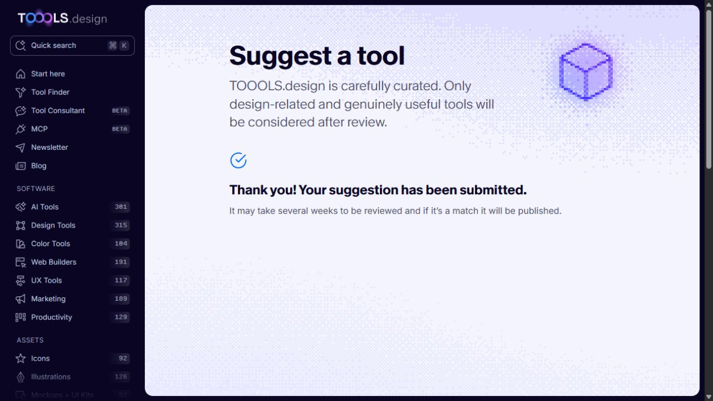

# Backlink authority execution — 2026-11-24

Mission #11. Observed date: **2026-11-24, Asia/Karachi**. Worktree: `khizology-dev`, branch `dev-dev`; starting HEAD `8a26d494220163852b2ae09946ab251c9115f513`. Production/main `329c5f04b3f9c39f55ba38ae5b503b24ba379e60`. Existing #13 changes on dev-dev were preserved, not deployed here. This record reports only actual observations/actions; no messages, purchases, votes, accounts or launches invented.

## BASELINE

[Canonical tracker](../docs/BACKLINK-TRACKER.md) contains source, target, anchor, rel, status, class and limitations.

- GitHub repository: public HTTP 200, real canonical homepage/deep links; owner-controlled C. Homepage links nofollow.
- LinkedIn Domain Arrivals post: public mention/anchor, nofollow redirect encoding HTTP destination, not direct canonical HTTPS. Excluded D; final redirect not followed. Separate Domain Arrivals website is not proven to link.
- FoundrList: anonymous rendered public product now verified, with real canonical homepage anchors. Newly verified existing presence, not a newly earned placement.
- **3 observed reference-bearing pages/domains including D; 2 direct canonical public referring domains (B=1, C=1). A=0.** Not an exhaustive web inventory.

Public discovery searched exact domain/brand, creator plus brand, Retry/Atlas canonical deep URLs and platform-specific names. Results/snippets were leads only. Stale snippets mentioning retired Notooo/old counts were not reused. Similar tool names, including polite-retry, were inspected and not counted without actual Khizooology links.

## QUALIFIED AUTHORITY

**Class A: 0 verified. New independent LIVE domains earned: 0.** The 5–10-domain milestone is not met. No ranking gain or causal search improvement claimed. A curated-platform submission alone is not independent endorsement.

## LEGITIMATE PRESENCE

**Class B: 1 verified existing domain — FoundrList.**

Source: https://foundrlist.com/product/khizooology (www redirects to apex).

Actual anchors: `Visit` and `khizooology.com`, both href `https://khizooology.com/`, rel `noopener`. Page-level robots: **noindex, nofollow**. Public page shows Khizooology, maker khizooo, **Launching soon / Not live yet**. Therefore public link is LIVE, product launch remains pending; no ranking-credit or completed-launch claim. Not inferred from Khizooology's footer badge. No upgrade or paid backlink package purchased.

## NEW RESEARCH

The [current plan](../docs/BACKLINK-AUTHORITY-PLAN.md#qualified-shortlist) records audience, asset fit, cost, editorial review, observable link type, risk and PURSUE/PREPARE/HOLD/REJECT decisions for 12 opportunities. Rules were rechecked from official sources.

- HN prohibits automated posting and generated/AI-edited text. Default priority changed because a legitimate human-authored post cannot be executed by the agent. No final generated HN title/comment provided.
- DevHunt offers free nofollow listing; $49 launch/dofollow and paid boosts are separate and rejected for this mission. No whole-project OSS license inferred from platform marketing.
- TOOOLS offers a free curated resource suggestion, description cap 120 characters, optional email/message. No reciprocal link or payment required in observed form.
- Peerlist requires a genuine individual profile and completed project; do not duplicate or solicit votes.
- Product Hunt needs coherent product identity, actual gallery and maker account. Old launch-guide article was 404; current guide collection/page-field help used.
- DEV's AI-assisted policy prohibits promotional/backlink-primary articles; owner review cannot make prohibited promotion acceptable.
- MERLOT free membership/material metadata does not license a third-party resource. Main service returned 503.
- ArtConnect offers free artist profiles. An actual public artist profile linked artist-owned external sites; Khizar's existing profile was not verified. Profile presence would be C, not independent A.
- SRE Weekly explicitly asks humans, not agents, to write/send submissions. Sidebar accepts own work but prioritizes substantial, recent/low-exposure resources; submission is login-gated. awesome-sre publishes contribution/duplicate/category rules.

## SUBMISSIONS

### TOOOLS.design — SUBMITTED, not LIVE

Submitted **once** through https://www.toools.design/submission after platform Quick search for `khizooology` showed no match. That is no observed duplicate, not exhaustive duplicate proof.

Exact submitted public fields:

- Name: **Bleed & Safe Area Builder**
- URL: https://khizooology.com/toolbox/bleed-safe-area-builder/
- Description: **Preview trim, bleed and safe margins for a print size, then export an SVG or PNG guide.**
- Pricing: **Free**
- Optional contact email: confirmed public contact from `src/data/site.ts`; not an invented address.
- Message: **Built by Khizar Imtiaz (khizooo). A browser-only layout guide for designers preparing print work. It helps visualize boundaries; users should confirm their printer’s bleed and safety requirements.**

Receipt: **“Thank you! Your suggestion has been submitted.”** Review notice says several weeks may be needed and publication depends on fit. No public listing URL supplied, no acceptance inferred, no inbound link counted. No account/newsletter/payment created.

### DevHunt — PREPARED, not SUBMITTED

Actual site search found no Khizooology result. Submit reached login, Google identity selection, then a first-time authorization for the site's Supabase authentication provider. Owner was asked to complete that authorization/account terms; no reply received during this execution. No Continue/terms acceptance or listing submission performed after that boundary. Handoff tab retained. No duplicate form retry or paid launch.

## LIVE LINKS

1. https://github.com/KhizaroOo/khizology — C, existing.
2. https://foundrlist.com/product/khizooology — B, existing/newly verified; page noindex/nofollow, prelaunch.

Excluded public reference: https://www.linkedin.com/posts/domain-arrivals_a-record-press-with-a-04-mm-nozzle-activity-7503030401972613120-CQ_E — D, redirect and roundup limits above.

**New live placements created by this mission: none verified.** TOOOLS receipt is separate from these source pages.

## REJECTIONS / HOLDS

- Reject paid dofollow launches/FoundrList backlink upgrades, bulk-directory services, bought votes and reciprocal-badge schemes. Nothing purchased/added.
- DB Weekly official site is archives only: not an active editorial destination.
- DevOps Weekly's public signup/privacy contact did not establish an editorial submission route; do not use a privacy contact as a pitch address.
- Sidebar requires login and recency/low-exposure check; MERLOT returned 503. No service access or acceptance invented.
- AlternativeTo simple-utility eligibility remains uncertain, not silently promoted from the historical hold. No generic art/backlink-directory submissions.

## OWNER ACTIONS

1. Complete first-time DevHunt authorization in the retained tab, then free listing can proceed. No credentials should be shared in chat.
2. HN post must be independently owner-written and posted. SRE Weekly also requests human-written/human-sent submission. These are genuine platform rules, not missing agent effort.
3. Peerlist/Product Hunt/ArtConnect/Sidebar were signed out; existing owner profiles/projects not established. Use real owner accounts, check duplicates, accept account terms personally if desired. No duplicate identities created.
4. MERLOT needs working service, membership/form access and accurate rights/category mapping.

No request to buy GSC Wizard: native account reports already provided useful evidence.

## REFERRAL EVIDENCE

Authenticated GSC domain-property **Links**: External links total **0**, top linking sites/pages/text **No data**. Sampled/delayed report, not total web truth. No export downloaded.

Authenticated Bing selected-site report: https://www.bing.com/webmasters/backlinks?siteUrl=https://khizooology.com/ — **No data available**. No referring domain/page/target/anchor totals exposed. Do not relabel unavailable data zero.

GA4 **Traffic acquisition: Session source / medium**, selected Last 30 days, **2026-10-25–2026-11-23**: **56 sessions**, direct/none **44**, google/organic **7**, not set **5**. All three rows inspected; no identifiable referral source. No placement traffic/engagement or conversion attribution established. Consent/referrer loss and existing allowlists limit interpretation; FoundrList/TOOOLS absent from parts of the current origin allowlist. No collection expanded. Platform listing views/clicks unavailable. No inquiry, revenue or ranking claims.

GSC Wizard connector returned payment_required/subscription_required; native UI above was used instead. No settings changed. No private account identifiers, request payloads or OAuth URLs stored in this report.

## NEXT PLACEMENTS

1. **DevHunt / Retry:** finish owner authorization, free listing only, inspect actual public page/rel afterward.
2. **Show HN / Retry:** owner authors usable-project post under current rules; no AI title/comment, automation or votes.
3. **Independent reliability reference:** owner considers human-only SRE Weekly or one useful awesome-sre contribution, not mass outreach.

### Reusable placement fields

**DevHunt:** Retry Storm Simulator; canonical Retry URL above; maker Khizar Imtiaz (khizooo); free. Description: “Compare original and retry traffic during a modeled outage. Explore backoff, jitter, attempt limits and budgets against capacity. Browser-only educational model; no real service is called.” Existing Toolooo identity, no blanket OSS-license claim. Capture actual safe-default result screenshot when browser access works, not fabricated numbers.

**HN factual worksheet, not publishable AI text:** built-in retry model; original requests versus attempts; backoff/jitter/attempt limits/budgets and capacity; direct runnable URL; deterministic educational assumptions; no production traffic/prediction. Owner supplies their own motivation, limitations, title and discussion. [Show HN](https://news.ycombinator.com/showhn.html) / [guidelines](https://news.ycombinator.com/newsguidelines.html).

**DEV owner-writing worksheet:** explain original requests vs attempts; 100 originals × maximum 3 total attempts = 300-attempt upper bound, **not 300 requests/second**. Show timed arrivals, waiting/backoff, jitter spreading retries, retry budgets, deadline limits and idempotency before any optional companion link. A timeout does not establish that a side effect failed; retry safety depends on operation semantics. Distinguish model assumptions from measured incidents. No invented case study or guaranteed safe settings. Primary reference: [AWS retries/backoff/jitter](https://aws.amazon.com/builders-library/timeouts-retries-and-backoff-with-jitter/). Owner independently writes/checks technical content; follow [DEV AI policy](https://dev.to/guidelines-for-ai-assisted-articles-on-dev), disclose assistance where used, no AI promotional post or AI comments.

**Product Hunt preparation (not saved draft):** choose **Toolooo by Khizooology**, coherent suite rather than 100 tiny launches. URL https://khizooology.com/toolbox/. Tagline: “Visual browser tools for technical and design problems”. Description: “Check API payloads, compare retry policies, plan deadlines and create print or drawing guides with 100 browser tools. Work with local inputs, inspect model limits, copy or export useful outputs, and continue to related tools. No account is required.” Count reflects current registry/release evidence, recheck before actual launch. Maker notes: Khizar built the suite; owner writes personal motivation without invented incidents. Logo source `src/data/monsters.ts`: `/images/Monsters/toolooo.png`; prepare platform-appropriate actual upload, not claimed ready. Gallery plan: real Retry capacity comparison, harmless API diagnosis, Bleed boundary/export preview; no Atlas screenshot for a Toolooo-only identity. Actual gallery not captured today. Proposed themes developer/design tools; choose up to three actual offered tags only after inspection. Feedback question: “Which tool helped you see a problem more clearly, and which assumption or next step was hardest to understand?” Current [page requirements](https://help.producthunt.com/en/articles/17834537-4-build-your-product-page) and [promotion rules](https://help.producthunt.com/en/articles/17734384-5-how-to-promote-your-launch-and-what-to-avoid); no vote requests.

**Peerlist:** use that one suite identity if no existing project; genuine owner profile required. No duplicate launches. [Eligibility](https://help.peerlist.io/individual/launchpad/how-to-launch-a-project-on-peerlist-launchpad).

**MERLOT:** Human Atlas — introductory 3D anatomy exploration. https://khizooology.com/infooo/human-atlas/. Adult male reference body, search/isolate, seven-stop introductory heart/lung guide; simplified education, not diagnosis, clinical training or all-body representation. Khizar adaptation/framing; preserve separate BodyParts3D/DBCLS CC BY 4.0 data and MIT upstream viewer notices. Do not label whole site/artwork CC. Select only real discipline/type/audience options and permissions justified by [material rules](https://info.merlot.org/merlothelp/Add_a_Material.htm).

**ArtConnect:** Khizar Imtiaz (khizooo), engineer and artist behind Khizooology; Artooo presents original sketches/illustrations and short artist context. Link https://khizooology.com/artworks/; use existing real artwork. No invented medium, dates, exhibitions, awards, sales or representation. [Platform](https://www.artconnect.com/); inspected public profile example https://www.artconnect.com/patrick-thompson-4C4siKlokC4hJeYZ_4zak supports the existence of meaningful profiles and outbound artist-site links, not Khizar eligibility/acceptance.

### Independent editorial packets — PREPARED, NOT SENT

**SRE Weekly:** [About/contact guidance](https://sreweekly.com/about-sre-weekly-2/) invites article suggestions via newsletter reply/direct address described there; do not infer an email from the domain. Owner writes/sends in their own words, per explicit human-only request. Facts: Khizar built Retry Storm; it visualizes attempts, capacity and bounded retry policies; direct Retry URL; simplified educational model, not measured production improvement. Relevant to reliability readers. No final agent-written pitch for this human-only destination.

**awesome-sre:** [repository](https://github.com/dastergon/awesome-sre), [contributing](https://github.com/dastergon/awesome-sre/blob/master/CONTRIBUTING.md). Suggested entry: `[Retry Storm Simulator](https://khizooology.com/toolbox/retry-storm-simulator/) — Browser-based educational model of retry amplification, capacity and bounded retry policies.` Verify existing list/PR duplicates and appropriate learning category before one PR. Follow required entry format/order. No PR created; editorial inclusion not claimed.

**Sidebar:** [submit](https://sidebar.io/submit), [guidelines](https://sidebar.io/about). Draft for owner review: “I’m Khizar, the engineer and artist behind Khizooology. I built Perspective Grid Maker to help people create one-, two- or three-point drawing guides in the browser and export a grid. It may be useful to readers practicing perspective: https://khizooology.com/toolbox/perspective-grid-maker/. It is a drawing aid, not a full artwork editor.” Login and recency/low-exposure fit required. No demand for a link, invented metrics or email sent.

## VERIFICATION

- Six production targets freshly fetched HTTP 200 with matching canonical, H1/static main content: homepage, Retry Storm, Bleed Builder, Human Atlas, Artooo, portfolio. Shared OG image HTTP 200. Public references and exact external anchors inspected; FoundrList additionally anonymous rendered browser inspection.
- Native GSC Links, Bing Backlinks and GA4 date/dimension/rows inspected. Official platform rules and submission form checked. TOOOLS receipt visibly confirmed and screenshot retained.
- Current in-app browser returned **ERR_NAME_NOT_RESOLVED** for Khizooology despite successful direct HTTP fetches. Fresh production mobile/runtime interaction checks could not be completed; not evidence of a global site DNS outage. No hosts/DNS/security settings changed.
- [Production acceptance Nov 18](PRODUCTION-ACCEPTANCE-2026-11-18.md) and [flagship readiness Nov 18](FLAGSHIP-PRODUCT-READINESS-2026-11-18.md) provide dated desktop/mobile/theme/export evidence, not newly repeated checks. This limits current per-asset quality confidence; no new runtime success asserted.
- Documentation/evidence only; no runtime, dependencies, metadata, analytics configuration or deployment changes. Final diff scope, document destinations and `git diff --check` checked before commit. No full build rerun for documentation-only changes.

**#11 BACKLINK & AUTHORITY GROWTH — IN PROGRESS, LIVE AUTHORITY EXPANDING**
